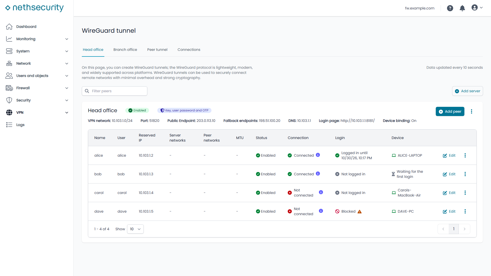
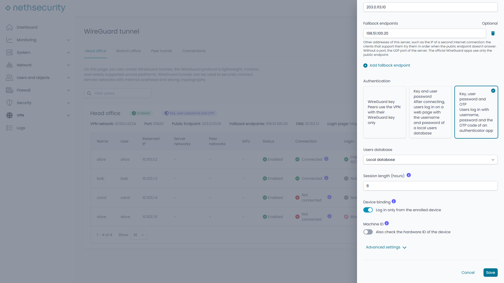
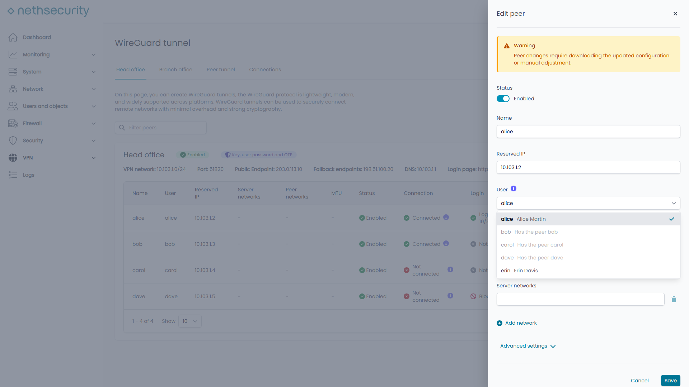
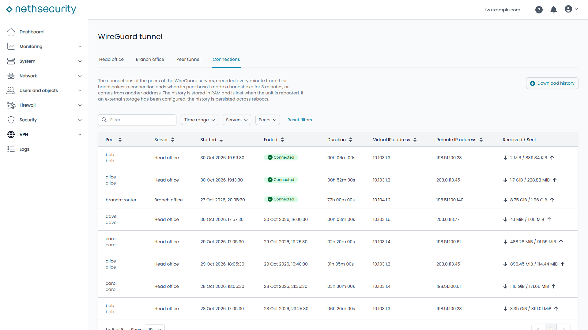
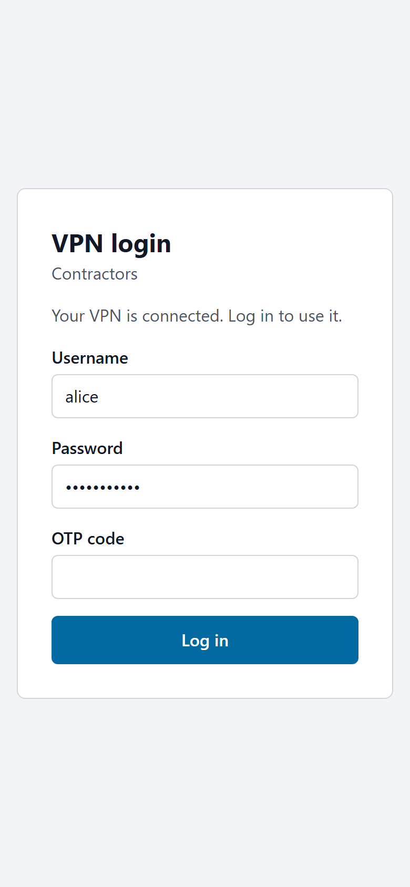
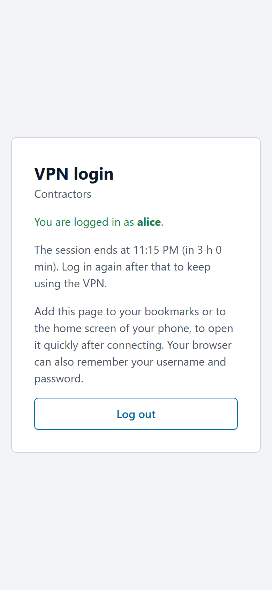
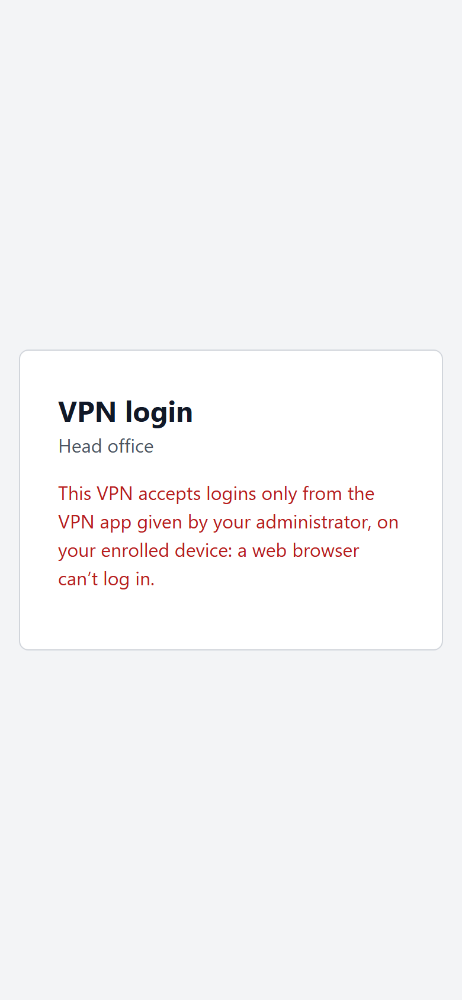

# NethSecurity

> [!WARNING]
> **This is a personal fork, and its changes are a proof of concept.** It isn't the official NethSecurity: Nethesis
> didn't make or review these changes and doesn't support them. They were written by an AI (Claude, by Anthropic),
> directed and tested by one person on test firewalls, and no security expert has reviewed them. Don't install the
> images of this fork on a firewall you rely on. For the official firewall, see
> [NethServer/nethsecurity](https://github.com/NethServer/nethsecurity).
>
> What the fork adds, each with a guide to test it:
> - **OpenVPN Road Warrior with several servers**: branch `feat/ovpnrw-multi-instance`, test images from `ci-fork`,
>   [FORK-TESTING.md](https://github.com/phatdo1819/nethsecurity/blob/feat/ovpnrw-multi-instance/FORK-TESTING.md).
> - **A login for WireGuard servers** (`ns-wgauth`): the peers log in on a web page, with the password of a local
>   user and an optional authenticator code, before their traffic passes; with device binding, fallback addresses,
>   connection history and one peer per user. Branch `feat/wireguard-user-auth`, test images from `ci-wgauth`,
>   [WGAUTH-TESTING.md](https://github.com/phatdo1819/nethsecurity/blob/ci-wgauth/WGAUTH-TESTING.md).

### The WireGuard login

With made-up names and documentation addresses, not a real firewall.

| | |
| --- | --- |
|  |  |
| A server that requires the login: who is connected, logged in, and from which device. A configuration used from two places at once blocks its peer. | Its settings: the key alone, or also a password and an OTP code; the users database, the session length, device binding. |
|  |  |
| A peer is linked to a user, one peer per user on a server. | The connection history of the servers, recorded from the handshakes. |

The login page, here on a phone. On a server without device binding (here "Contractors"), the peers log in with any
browser, as with the official WireGuard apps. With device binding (Head office), only the app enrolled on the device
can log in, and the page says so.

  

---

The rest of this page is the README of the official project.

NethSecurity is an Open Source Linux firewall, a downstream rebuild of [OpenWrt](https://openwrt.org/).
It's the successor of [NethServer 7 firewall suite](https://docs.nethserver.org/).

## Purpose

NethSecurity provides a robust, secure, and manageable firewall solution for networks of all sizes, with a focus on ease of use and flexibility.
It is primarily designed for x86_64 machines, though support for other architectures may be added in the future.

## Installation

See the [installation guide](https://docs.nethsecurity.org/en/latest/install.html) for detailed instructions.

## Further documentation

Screenshots and more information at the :point_right: [official site](https://www.nethsecurity.org/).

To get started with NethSecurity, check out the [Administrator manual](https://docs.nethsecurity.org/). :book:

:hammer_and_wrench: If you are a developer, you can find useful information inside the [Developer manual](https://dev.nethsecurity.org/)
and the [Developer handbook](https://handbook.nethserver.org/).

## Support requests

:ring_buoy: For support requests and questions, please use the [community forum](https://community.nethserver.org/).

## Reporting bugs

:heavy_exclamation_mark: Before reporting a new issue, discuss it on [community.nethserver.org](https://community.nethserver.org).

See the [CONTRIBUTING.md](.github/CONTRIBUTING.md) file for more details.

